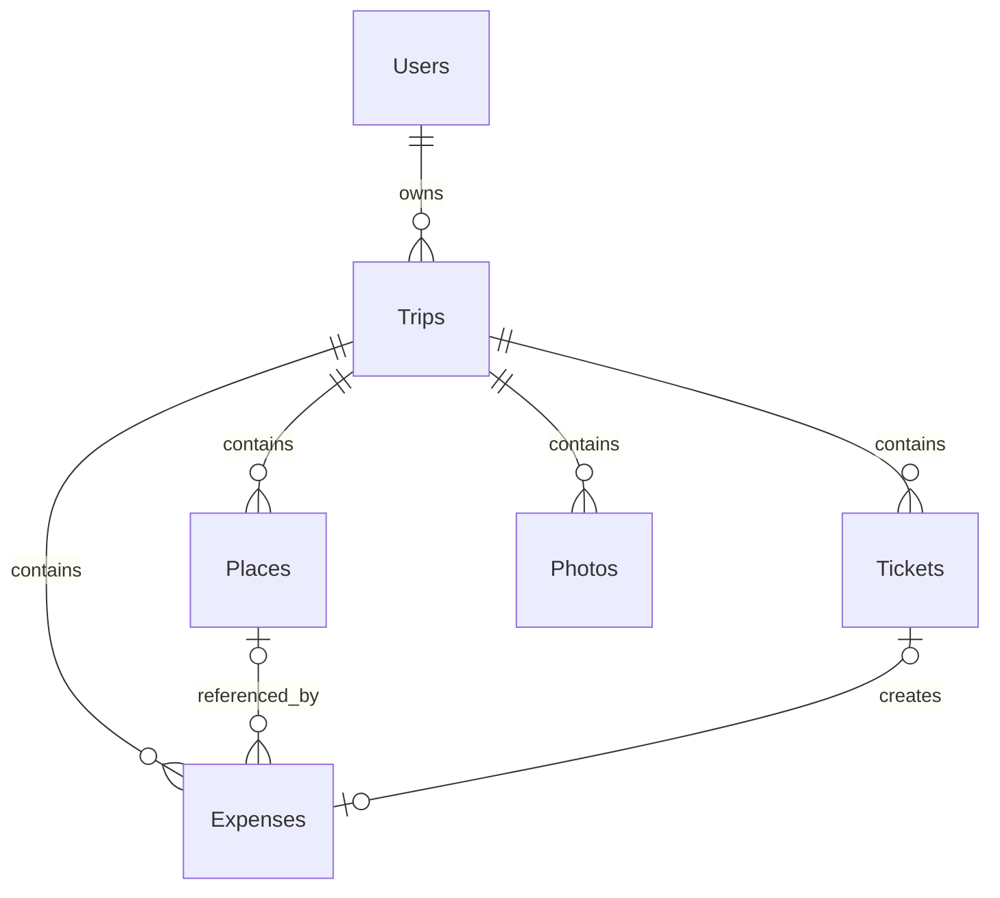

# Tripy — структура базы данных

Фактическая схема находится в `database/schema.sql`. Она содержит 6 таблиц. Все таблицы используют InnoDB, `utf8mb4` и сопоставление `utf8mb4_unicode_ci`.

## ER-диаграмма



Текстовые связи:

```text
Users 1 -> N Trips
Trips 1 -> N Places
Trips 1 -> N Tickets
Trips 1 -> N Expenses
Trips 1 -> N Photos
Places 1 -> N Expenses, связь расхода необязательна
Tickets 1 -> 0..1 Expenses, связь расхода необязательна и уникальна
```

## Users

| Поле | Тип | NULL | Значение по умолчанию | Назначение |
|---|---|---:|---|---|
| `user_id` | `INT UNSIGNED` | нет | AUTO_INCREMENT | Первичный ключ |
| `username` | `VARCHAR(80)` | нет | — | Уникальный логин |
| `password_hash` | `VARCHAR(255)` | нет | — | Хеш пароля |
| `created_at` | `TIMESTAMP` | нет | `CURRENT_TIMESTAMP` | Дата создания |

Ключи: `PRIMARY KEY (user_id)`, уникальный индекс на `username`.

Схема добавляет техническую запись `owner` с отключённым входом. Это не демонстрационное путешествие и не рабочая авторизация.

## Trips

| Поле | Тип | NULL | Значение по умолчанию | Назначение |
|---|---|---:|---|---|
| `trip_id` | `INT UNSIGNED` | нет | AUTO_INCREMENT | Первичный ключ |
| `user_id` | `INT UNSIGNED` | нет | — | Владелец |
| `title` | `VARCHAR(140)` | нет | — | Название |
| `destination` | `VARCHAR(180)` | нет | — | Город и страна одной строкой |
| `start_date` | `DATE` | нет | — | Начало |
| `end_date` | `DATE` | нет | — | Окончание |
| `budget_limit` | `DECIMAL(12,2)` | да | `NULL` | Плановый бюджет |
| `cover_path` | `VARCHAR(255)` | да | `NULL` | Относительный путь обложки |
| `notes` | `TEXT` | да | `NULL` | Заметки |
| `created_at` | `TIMESTAMP` | нет | `CURRENT_TIMESTAMP` | Дата создания |
| `updated_at` | `TIMESTAMP` | нет | `CURRENT_TIMESTAMP`, автообновление | Дата изменения |

Ключи: `PRIMARY KEY (trip_id)`, индекс `idx_trips_user_dates (user_id, start_date, end_date)`. Внешний ключ `user_id -> Users.user_id ON DELETE CASCADE`.

## Places

| Поле | Тип | NULL | Значение по умолчанию | Назначение |
|---|---|---:|---|---|
| `place_id` | `INT UNSIGNED` | нет | AUTO_INCREMENT | Первичный ключ |
| `trip_id` | `INT UNSIGNED` | нет | — | Путешествие |
| `place_name` | `VARCHAR(140)` | нет | — | Название места |
| `category` | `VARCHAR(80)` | да | `NULL` | Категория |
| `address` | `VARCHAR(255)` | да | `NULL` | Адрес |
| `notes` | `TEXT` | да | `NULL` | Заметка |
| `planned_cost` | `DECIMAL(12,2)` | да | `NULL` | Плановая стоимость, UI пока не использует |
| `status` | `ENUM('planned','visited')` | нет | `planned` | Статус посещения |
| `created_at` | `TIMESTAMP` | нет | `CURRENT_TIMESTAMP` | Дата создания |

Ключи: `PRIMARY KEY (place_id)`, индекс `idx_places_trip_status (trip_id, status)`. Внешний ключ `trip_id -> Trips.trip_id ON DELETE CASCADE`.

## Tickets

| Поле | Тип | NULL | Значение по умолчанию | Назначение |
|---|---|---:|---|---|
| `ticket_id` | `INT UNSIGNED` | нет | AUTO_INCREMENT | Первичный ключ |
| `trip_id` | `INT UNSIGNED` | нет | — | Путешествие |
| `title` | `VARCHAR(160)` | нет | — | Название |
| `ticket_type` | `VARCHAR(80)` | да | `NULL` | Тип |
| `use_date` | `DATE` | да | `NULL` | Дата использования |
| `file_path` | `VARCHAR(255)` | нет | — | Безопасный относительный путь |
| `file_extension` | `VARCHAR(10)` | нет | — | Проверенный формат |
| `original_name` | `VARCHAR(255)` | нет | — | Исходное имя для скачивания |
| `notes` | `TEXT` | да | `NULL` | Примечание |
| `is_pinned` | `TINYINT(1)` | нет | `0` | Закрепление |
| `cost` | `DECIMAL(12,2)` | да | `NULL` | Стоимость |
| `include_in_expenses` | `TINYINT(1)` | нет | `0` | Учитывать стоимость в расходах |
| `created_at` | `TIMESTAMP` | нет | `CURRENT_TIMESTAMP` | Дата создания |
| `updated_at` | `TIMESTAMP` | нет | `CURRENT_TIMESTAMP`, автообновление | Дата изменения |

Ключи: `PRIMARY KEY (ticket_id)`, индекс `idx_tickets_trip_pinned (trip_id, is_pinned)`. Внешний ключ `trip_id -> Trips.trip_id ON DELETE CASCADE`.

## Expenses

| Поле | Тип | NULL | Значение по умолчанию | Назначение |
|---|---|---:|---|---|
| `expense_id` | `INT UNSIGNED` | нет | AUTO_INCREMENT | Первичный ключ |
| `trip_id` | `INT UNSIGNED` | нет | — | Путешествие |
| `place_id` | `INT UNSIGNED` | да | `NULL` | Необязательное место |
| `ticket_id` | `INT UNSIGNED` | да | `NULL` | Необязательный билет |
| `title` | `VARCHAR(160)` | нет | — | Название |
| `amount` | `DECIMAL(12,2)` | нет | — | Сумма |
| `category` | `VARCHAR(80)` | нет | — | Категория |
| `expense_date` | `DATE` | нет | — | Дата |
| `notes` | `TEXT` | да | `NULL` | Примечание |
| `created_at` | `TIMESTAMP` | нет | `CURRENT_TIMESTAMP` | Дата создания |
| `updated_at` | `TIMESTAMP` | нет | `CURRENT_TIMESTAMP`, автообновление | Дата изменения |

Ключи: `PRIMARY KEY (expense_id)`, уникальный ключ `uq_expenses_ticket (ticket_id)`, индекс `idx_expenses_trip_date (trip_id, expense_date)`.

Внешние ключи:

- `trip_id -> Trips.trip_id ON DELETE CASCADE`;
- `place_id -> Places.place_id ON DELETE SET NULL`;
- `ticket_id -> Tickets.ticket_id ON DELETE CASCADE`.

Уникальный `ticket_id` предотвращает двойной учёт стоимости одного билета. Сервер использует `INSERT ... ON DUPLICATE KEY UPDATE`, поэтому изменение стоимости обновляет связанную запись.

## Photos

| Поле | Тип | NULL | Значение по умолчанию | Назначение |
|---|---|---:|---|---|
| `photo_id` | `INT UNSIGNED` | нет | AUTO_INCREMENT | Первичный ключ |
| `trip_id` | `INT UNSIGNED` | нет | — | Путешествие |
| `file_path` | `VARCHAR(255)` | нет | — | Относительный путь |
| `caption` | `VARCHAR(180)` | да | `NULL` | Подпись |
| `photo_date` | `DATE` | да | `NULL` | Дата фотографии |
| `description` | `TEXT` | да | `NULL` | Описание |
| `is_cover` | `TINYINT(1)` | нет | `0` | Зарезервированный признак обложки |
| `created_at` | `TIMESTAMP` | нет | `CURRENT_TIMESTAMP` | Дата создания |

Ключи: `PRIMARY KEY (photo_id)`, индекс `idx_photos_trip_date (trip_id, photo_date)`. Внешний ключ `trip_id -> Trips.trip_id ON DELETE CASCADE`.

## Целостность и миграции

- Удаление пользователя каскадно удаляет путешествия и их зависимые записи.
- Удаление путешествия каскадно удаляет места, билеты, расходы и фотографии в БД; PHP дополнительно удаляет связанные файлы.
- Удаление билета каскадно удаляет связанный расход.
- Удаление места сохраняет расход, устанавливая `place_id = NULL`.
- Денежные значения хранятся в `DECIMAL`, а не `FLOAT`.
- Отдельных миграций в проекте нет; `schema.sql` предназначен для первичного развёртывания пустой базы.

Во время финальной ревизии схема и данные рабочей базы не изменялись.
