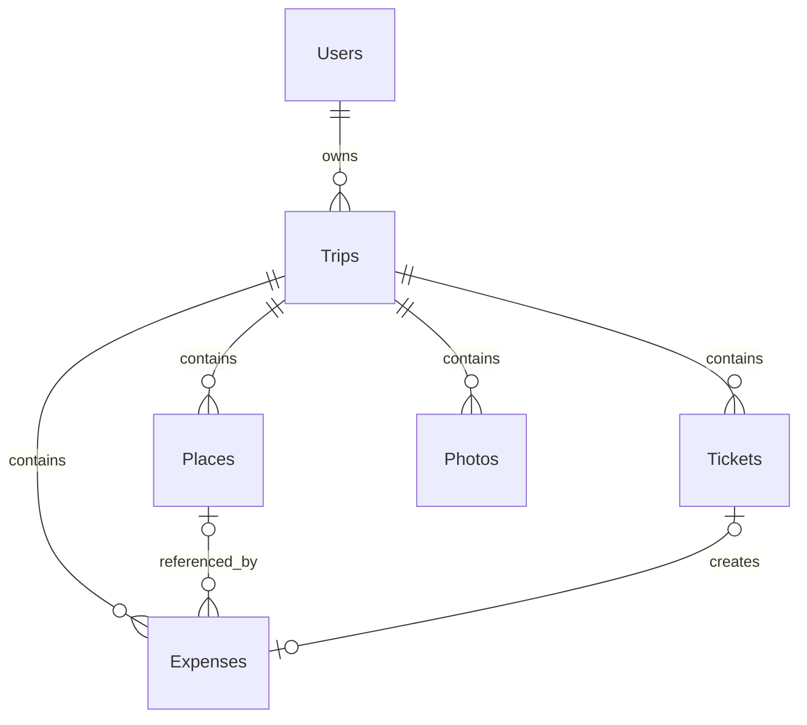

# Tripy — технический отчёт

Дата ревизии: 27 октября 2026 года.

## 1. Общая информация

Tripy — информационная система «Планировщик путешествий». Веб-приложение предназначено для владельца, который создаёт поездки, хранит сведения о направлениях и датах, ведёт список мест, добавляет документы поездки, учитывает расходы и формирует фотогалерею.

Основной сценарий начинается с создания путешествия. После сохранения пользователь переходит на страницу поездки и работает с вкладками «Билеты», «Места», «Расходы» и «Фото». Данные записываются в MySQL/MariaDB, а загруженные обложки, фотографии и документы хранятся в файловой системе сервера. В базе сохраняются относительные пути и метаданные.

Приложение не бронирует билеты и отели, не продаёт туристические услуги и не обращается к внешним туристическим API. Функция списка вещей отсутствует и в проект не добавлялась.

Ревизия выполнялась без публикации и без изменения рабочей базы. Перед очисткой создана проверенная резервная копия `/tmp/Tripy_before_final_review_20261027.zip`.

## 2. Используемые технологии

| Технология | Фактическое назначение |
|---|---|
| HTML5 | Структура страниц, форм, диалогов, навигации и вкладок |
| CSS3 | Сетка, Flexbox, компоненты, состояния и фирменное оформление |
| JavaScript | Сайдбар, фильтры, календари, диалоги, вкладки, AJAX и обновление интерфейса |
| PHP 8.x | Формирование страниц, сессии, CSRF, серверная проверка, CRUD, загрузка и выдача файлов |
| PDO | Подключение к MySQL и подготовленные запросы |
| MySQL/MariaDB | Постоянное хранение шести связанных сущностей |
| Apache `.htaccess` | Запрет индексации, защита каталогов и загруженных файлов |
| Manrope | Интерфейсный шрифт из Google Fonts |
| SVG | Локальные и встроенные минималистичные иконки |

Фреймворки, Composer, Node.js, npm-пакеты, Docker и серверная сборка не используются. Внешняя зависимость интерфейса только одна — веб-шрифт Google Fonts; при недоступности сети используется системный шрифт.

Обложки принимаются в JPG, PNG и WebP до 8 МБ. Фотографии — JPG, PNG и WebP до 10 МБ. Билеты — PDF, JPG и PNG до 10 МБ. MIME определяется на сервере через `finfo`, серверные имена генерируются случайно.

## 3. Архитектура проекта

Tripy — компактное серверное PHP-приложение без роутера и шаблонизатора. Каждая основная страница имеет отдельный PHP-файл, общие части подключаются через `require`.

```text
Браузер -> PHP-страница -> репозиторий -> bootstrap/PDO -> MySQL
Браузер -> POST/AJAX -> actions или API
                        -> метод + CSRF + владелец + валидация
                        -> MySQL и/или uploads
                        -> JSON или redirect -> интерфейс
```

`includes/bootstrap.php` запускает сессию, загружает приватный `config/config.php`, устанавливает часовой пояс, создаёт PDO, выдаёт CSRF-токен и предоставляет экранирование. `includes/trip-repository.php` содержит операции чтения и преобразование строк БД. Изменяющие операции разделены между обработчиками путешествий, фотографий и единым API внутренней страницы.

Навигация формируется в `includes/header.php`. Активный пункт задаётся `$activePage`. Состояние ширины сайдбара сохраняется в `localStorage`; бизнес-данные там не хранятся.

Файлы помещаются в `uploads/covers`, `uploads/photos` и `uploads/tickets`. В БД записывается относительный путь. Изображения выводятся через ``. Для билетов прямой доступ закрыт, а `download-ticket.php` проверяет путешествие и технического владельца, затем отдаёт файл inline или как вложение.

## 4. Структура файлов и папок

```text
Tripy/
├── index.php                  главная и статистика
├── trips.php                  список путешествий
├── trip.php                   рабочее пространство поездки
├── gallery.php                общая галерея
├── download-ticket.php        просмотр/скачивание билета
├── database-check.php         отключённая диагностика БД
├── actions/                   обработчики путешествий и фото
├── api/trip-actions.php       места, билеты, расходы, бюджет
├── includes/                  общая оболочка и доступ к данным
├── assets/
│   ├── css/                   три файла стилей
│   ├── js/                    три клиентских сценария
│   ├── icons/                 plane.svg и train.svg
│   └── images/                логотип, hero и заглушка обложки
├── config/
│   ├── .htaccess
│   └── config.example.php     шаблон без секретов
├── database/
│   ├── .htaccess
│   └── schema.sql             пустая схема из шести таблиц
├── uploads/                   обложки, фото и закрытые билеты
├── .htaccess
├── .gitignore
├── robots.txt
├── README.md
└── TRIPY_*.md                 техническая документация
```

Назначение основных обработчиков:

- `actions/trip-save.php` — создание и обновление путешествия и обложки;
- `actions/trip-delete.php` — удаление поездки и принадлежащих ей файлов;
- `actions/photo-save.php` — проверка, загрузка и запись фотографии;
- `api/trip-actions.php` — изменение мест, билетов, расходов, бюджета и удаление фото;
- `download-ticket.php` — контролируемая выдача документа;
- `includes/trip-form-modal.php` — единая форма создания и редактирования;
- `includes/trip-repository.php` — чтение списков, статистики и групп фото;
- `includes/trips-data.php` — форматирование дат и вычисление статуса.

## 5. Функциональные возможности

### Главная страница

Главная показывает баннер и кнопку создания путешествия. Статистика рассчитывается SQL-запросом: поездки, предстоящие поездки, уникальные страны завершённых поездок, посещённые места и фотографии. Блок моментов показывает до четырёх последних фотографий из `Photos`; при отсутствии данных остаются заглушки. Доступна форма создания поездки.

### Путешествия

Список загружается из MySQL и отображается карточками-билетами. Статус вычисляется по датам. Доступны фильтры и сортировка. Карточка показывает обложку, направление, название, даты, продолжительность, бюджет и места.

Создание и редактирование используют один модальный компонент. Обязательны город, страна и диапазон дат; бюджет и обложка необязательны. Календарь поддерживает разные месяцы и поездку на один день. При создании сервер возвращает ID и браузер открывает новую поездку. При редактировании сохраняются ID и связанные записи. Удаление подтверждается и удаляет зависимые строки и файлы.

### Страница путешествия

Верхняя карточка показывает обложку, направление, название, диапазон и продолжительность. Редактирование открывает заполненную форму. Вкладки расположены в порядке «Билеты», «Места», «Расходы», «Фото»; первая активна по умолчанию, переключение не перезагружает страницу.

### Билеты

Сохраняются название, тип, дата, путь, формат, исходное имя, примечание, закрепление, стоимость и признак включения в расходы. Создание требует название и файл. Редактирование не требует повторной загрузки. Закреплённые записи сортируются первыми. PDF и изображения открываются во встроенном просмотре; оригинал скачивается через защищённый обработчик. Доступны редактирование, закрепление и удаление.

Если стоимость включена в расходы, в транзакции создаётся или обновляется единственный расход с `ticket_id`. Уникальный ключ не допускает дубликаты. При выключении учёта связанный расход удаляется. При удалении билета он удаляется каскадно.

### Места

Сохраняются название, категория, адрес, заметка и статус. Название обязательно. Доступны создание, просмотр, редактирование, удаление и переключение статуса. Посещение места не создаёт расход.

### Расходы

Сохраняются название, положительная сумма, категория, дата, примечание и необязательные связи. Если дата не указана, сервер ставит текущую. Обычные расходы поддерживают полный CRUD. Связанные с билетом изменяются через билет.

`Потрачено` — сумма `Expenses.amount`. Остаток равен бюджету минус потрачено. Без бюджета не показывается фиктивный ноль. При превышении остаток и шкала получают предупреждающее состояние.

### Фотографии и галерея

Фотография связывается с поездкой по `trip_id`; можно указать подпись, дату и описание. Внутри поездки доступны загрузка, просмотр и удаление. Редактирование метаданных отсутствует. Общая галерея использует те же строки, группирует их по путешествиям и открывает lightbox. Главная использует тот же источник последних фото.

### Другие функции

Сайдбар сворачивается и сохраняет визуальное состояние. Окно «О проекте» закрывается кнопкой, фоном и Escape. Формы показывают пользовательские ошибки без внутренних сообщений MySQL. Есть уведомления и пустые состояния. Полный перечень находится в `TRIPY_FUNCTIONALITY.md`.

## 6. База данных — полный разбор

Используется MySQL/MariaDB. Реальное имя рабочей базы намеренно не включено в архив. Схема содержит ровно 6 таблиц.

### Users

| Поле | Тип | NULL | Ключ | По умолчанию | Назначение |
|---|---|---|---|---|---|
| user_id | INT UNSIGNED | нет | PK, AI | — | Идентификатор |
| username | VARCHAR(80) | нет | UNIQUE | — | Логин |
| password_hash | VARCHAR(255) | нет | — | — | Хеш пароля |
| created_at | TIMESTAMP | нет | — | CURRENT_TIMESTAMP | Создание |

### Trips

| Поле | Тип | NULL | Ключ | По умолчанию | Назначение |
|---|---|---|---|---|---|
| trip_id | INT UNSIGNED | нет | PK, AI | — | Идентификатор |
| user_id | INT UNSIGNED | нет | FK, INDEX | — | Владелец |
| title | VARCHAR(140) | нет | — | — | Название |
| destination | VARCHAR(180) | нет | — | — | Направление |
| start_date | DATE | нет | INDEX | — | Начало |
| end_date | DATE | нет | INDEX | — | Окончание |
| budget_limit | DECIMAL(12,2) | да | — | NULL | Бюджет |
| cover_path | VARCHAR(255) | да | — | NULL | Путь обложки |
| notes | TEXT | да | — | NULL | Заметки |
| created_at | TIMESTAMP | нет | — | CURRENT_TIMESTAMP | Создание |
| updated_at | TIMESTAMP | нет | — | CURRENT_TIMESTAMP | Автообновление |

### Places

| Поле | Тип | NULL | Ключ | По умолчанию | Назначение |
|---|---|---|---|---|---|
| place_id | INT UNSIGNED | нет | PK, AI | — | Идентификатор |
| trip_id | INT UNSIGNED | нет | FK, INDEX | — | Путешествие |
| place_name | VARCHAR(140) | нет | — | — | Название |
| category | VARCHAR(80) | да | — | NULL | Категория |
| address | VARCHAR(255) | да | — | NULL | Адрес |
| notes | TEXT | да | — | NULL | Заметка |
| planned_cost | DECIMAL(12,2) | да | — | NULL | Плановая стоимость |
| status | ENUM('planned','visited') | нет | INDEX | planned | Статус |
| created_at | TIMESTAMP | нет | — | CURRENT_TIMESTAMP | Создание |

### Tickets

| Поле | Тип | NULL | Ключ | По умолчанию | Назначение |
|---|---|---|---|---|---|
| ticket_id | INT UNSIGNED | нет | PK, AI | — | Идентификатор |
| trip_id | INT UNSIGNED | нет | FK, INDEX | — | Путешествие |
| title | VARCHAR(160) | нет | — | — | Название |
| ticket_type | VARCHAR(80) | да | — | NULL | Тип |
| use_date | DATE | да | — | NULL | Дата использования |
| file_path | VARCHAR(255) | нет | — | — | Безопасный путь |
| file_extension | VARCHAR(10) | нет | — | — | Формат |
| original_name | VARCHAR(255) | нет | — | — | Исходное имя |
| notes | TEXT | да | — | NULL | Примечание |
| is_pinned | TINYINT(1) | нет | INDEX | 0 | Закрепление |
| cost | DECIMAL(12,2) | да | — | NULL | Стоимость |
| include_in_expenses | TINYINT(1) | нет | — | 0 | Учёт в расходах |
| created_at | TIMESTAMP | нет | — | CURRENT_TIMESTAMP | Создание |
| updated_at | TIMESTAMP | нет | — | CURRENT_TIMESTAMP | Автообновление |

### Expenses

| Поле | Тип | NULL | Ключ | По умолчанию | Назначение |
|---|---|---|---|---|---|
| expense_id | INT UNSIGNED | нет | PK, AI | — | Идентификатор |
| trip_id | INT UNSIGNED | нет | FK, INDEX | — | Путешествие |
| place_id | INT UNSIGNED | да | FK | NULL | Место |
| ticket_id | INT UNSIGNED | да | FK, UNIQUE | NULL | Билет |
| title | VARCHAR(160) | нет | — | — | Название |
| amount | DECIMAL(12,2) | нет | — | — | Сумма |
| category | VARCHAR(80) | нет | — | — | Категория |
| expense_date | DATE | нет | INDEX | — | Дата |
| notes | TEXT | да | — | NULL | Примечание |
| created_at | TIMESTAMP | нет | — | CURRENT_TIMESTAMP | Создание |
| updated_at | TIMESTAMP | нет | — | CURRENT_TIMESTAMP | Автообновление |

### Photos

| Поле | Тип | NULL | Ключ | По умолчанию | Назначение |
|---|---|---|---|---|---|
| photo_id | INT UNSIGNED | нет | PK, AI | — | Идентификатор |
| trip_id | INT UNSIGNED | нет | FK, INDEX | — | Путешествие |
| file_path | VARCHAR(255) | нет | — | — | Путь изображения |
| caption | VARCHAR(180) | да | — | NULL | Подпись |
| photo_date | DATE | да | INDEX | NULL | Дата |
| description | TEXT | да | — | NULL | Описание |
| is_cover | TINYINT(1) | нет | — | 0 | Зарезервированный признак |
| created_at | TIMESTAMP | нет | — | CURRENT_TIMESTAMP | Создание |

Полный разбор индексов, внешних ключей и удаления находится в `TRIPY_DATABASE.md`.

## 7. Связи между таблицами



Все связи закреплены FOREIGN KEY:

- `Users.user_id -> Trips.user_id`, 1:N, `ON DELETE CASCADE`;
- `Trips.trip_id -> Places.trip_id`, 1:N, `ON DELETE CASCADE`;
- `Trips.trip_id -> Tickets.trip_id`, 1:N, `ON DELETE CASCADE`;
- `Trips.trip_id -> Expenses.trip_id`, 1:N, `ON DELETE CASCADE`;
- `Trips.trip_id -> Photos.trip_id`, 1:N, `ON DELETE CASCADE`;
- `Places.place_id -> Expenses.place_id`, 1:N с необязательной ссылкой, `ON DELETE SET NULL`;
- `Tickets.ticket_id -> Expenses.ticket_id`, 1:0..1 благодаря UNIQUE, `ON DELETE CASCADE`.

Незакреплённых логических связей между бизнес-таблицами не обнаружено. Путь файла — ссылка на файловую систему, а не внешний ключ.

## 8. Хранимая информация

MySQL хранит идентификаторы, владельца, названия, направления, даты, бюджет, статусы, категории, суммы, заметки, признаки закрепления/учёта, исходные имена файлов и относительные пути. Пароль должен храниться только хешем; технический владелец имеет `LOGIN_DISABLED` и не используется для входа.

Файловая система хранит бинарные обложки, фотографии и билеты. BLOB не используется. Сессия PHP хранит CSRF, flash и в будущем `user_id`. `localStorage` хранит только состояние сайдбара. Реальные секреты находятся только в исключённом `config/config.php`.

## 9. CRUD-операции

| Сущность | Create | Read | Update | Delete | Реализация |
|---|---:|---:|---:|---:|---|
| Users | нет UI | техническое чтение | нет | нет | bootstrap, schema |
| Trips | да | да | да | да | trip-save, trip-delete, repository |
| Places | да | да | да | да | trip-actions API |
| Tickets | да | да | да | да | API, download-ticket |
| Expenses | да | да | да | да | API; связанные через билет |
| Photos | да | да | нет изменения метаданных | да внутри поездки | photo-save, API |

Все записи выполняются подготовленными запросами. Билет и связанный расход меняются в транзакции. При удалении поездки PHP получает пути, удаляет строку с каскадами, а затем удаляет файлы.

## 10. Проверка безопасности

Реализовано: PDO prepared statements, отключённая эмуляция, CSRF, проверка владельца, HTML-экранирование, серверная проверка полей/дат/сумм, MIME и размера, случайные имена, блокировка исполняемых файлов в `uploads`, закрытая выдача билетов, закрытые `config` и `database`, отсутствие исключений PDO в интерфейсе.

Критическая проблема: полноценной авторизации нет. Все посетители используют `default_user_id`, поэтому текущая проверка владельца не изолирует разных посетителей. До реализации входа сайт следует считать однопользовательским и не использовать для чувствительных документов.

Значительные ограничения:

- фотографии и обложки публичны по прямому URL;
- нет ограничения частоты запросов и журнала действий;
- защита зависит от поддержки `.htaccess`;
- нет антивирусного анализа PDF;
- исходные имена билетов являются пользовательскими данными.

Незначительные ограничения: Manrope не хранится локально, `<dialog>` требует современный браузер, диагностический файл остаётся на сервере, хотя выключен и отвечает 404.

В ревизии удалены конкретные реквизиты БД из шаблона/README, добавлена проверка даты фото и очистка новых файлов при ошибке записи.

## 11. Развёртывание

### Локально

1. Установить PHP 8.x с PDO MySQL и Fileinfo, MySQL/MariaDB и Apache либо XAMPP.
2. Скопировать проект в каталог сервера.
3. Создать пустую базу `utf8mb4` и один раз импортировать `database/schema.sql`.
4. Скопировать `config/config.example.php` в `config/config.php` и заполнить параметры.
5. Проверить права записи в трёх подкаталогах `uploads`.
6. Открыть корень проекта в браузере.

Для встроенного сервера: `php -S localhost:8000`. На Windows без PATH: `C:\xampp\php\php.exe -S localhost:8000`.

### InfinityFree

1. Загрузить содержимое проекта в `/htdocs`.
2. Не импортировать схему повторно, если таблицы существуют.
3. Создать серверный `config/config.php` из шаблона и заполнить значениями панели.
4. Не помещать пароль в JS, SQL, README или репозиторий.
5. Проверить каталоги загрузки.
6. После резервной копии можно кратковременно включить `enable_db_check`, открыть диагностику и сразу отключить её.

## 12. Ограничения и особенности

- нет авторизации, регистрации и административного интерфейса;
- проект фактически однопользовательский;
- нет редактирования метаданных фото;
- `planned_cost` и `Photos.is_cover` текущий UI не использует;
- нет валютной модели, карты, погоды, бронирования и интеграций;
- нет списка вещей;
- нет автоматических тестов и миграционного механизма;
- рабочая база и серверная конфигурация не изменялись;
- PHP CLI отсутствует, поэтому `php -l` не выполнен;
- финальная локальная версия не запускалась через PHP-сервер;
- сохранение после обновления требует контрольной проверки на InfinityFree после публикации.

## 13. Итоговая характеристика

Tripy представляет собой специализированное веб-приложение для централизованного хранения информации о личных путешествиях. Разработка выполнена в клиент-серверной архитектуре. Клиентская часть отвечает за представление и интерактивность, а PHP выполняет проверку запросов, работу с файлами и доступ к реляционной базе через PDO.

Основной объект системы — путешествие. Для него задаются направление, период, необязательный бюджет и обложка. С путешествием связаны места, билеты, расходы и фотографии. Такая структура хранит материалы одной поездки в едином контексте, а внешние ключи обеспечивают целостность. Удаление поездки каскадно удаляет зависимые строки; файлы дополнительно удаляются PHP-кодом.

Пользователь работает со списком поездок и отдельным пространством путешествия. Карточки отражают даты, статус и показатели. На внутренней странице билеты можно загружать, просматривать, закреплять и связывать с расходами. Места поддерживают статус посещения. Финансовый раздел показывает бюджет, траты и остаток. Фотографии одной таблицы используются внутри поездки, общей галереей и главной.

Модель включает шесть таблиц: Users, Trips, Places, Tickets, Expenses и Photos. Денежные значения хранятся в DECIMAL. Расход из билета связан уникальным внешним ключом, что предотвращает двойной учёт. Файлы не помещаются в БД; сохраняются пути и метаданные.

Реализованы базовые меры надёжности: подготовленные запросы, CSRF, серверная валидация, экранирование, MIME-проверка, случайные имена и защита каталогов. Главным ограничением остаётся отсутствие авторизации. Технический владелец обеспечивает согласованность запросов, но не изоляцию разных посетителей.

По итогам ревизии удалены устаревшие архивы, скриншоты, дубли изображений и неиспользуемый код. Секреты исключены, обработка файлов усилена, документация синхронизирована с фактической реализацией. Проект остаётся простым для PHP/MySQL-хостинга и подходит как завершённая учебная основа; дальнейшие возможности явно отделены от реализованных.

## 14. Статус проверки

Выполнены инвентаризация, проверка ссылок, статический анализ PHP/SQL/JS, поиск секретов и отладочного кода, синтаксическая проверка JavaScript и проверка ZIP. Не выполнены PHP lint, браузерный запуск финальной локальной версии и CRUD с рабочей MySQL. Поэтому отчёт не заявляет о полном динамическом тестировании.
